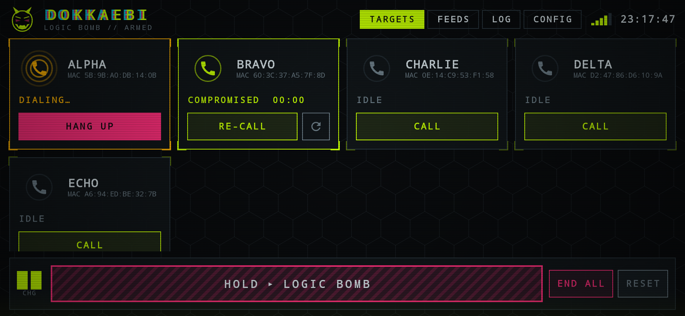
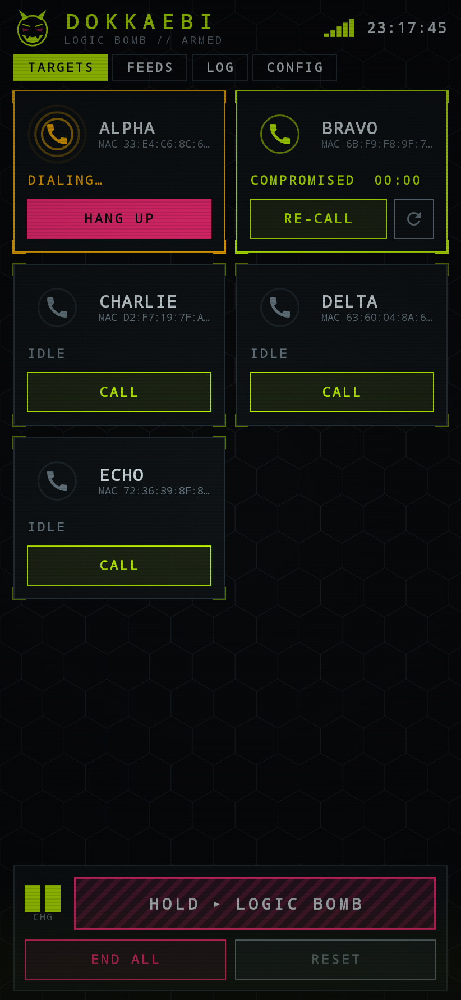
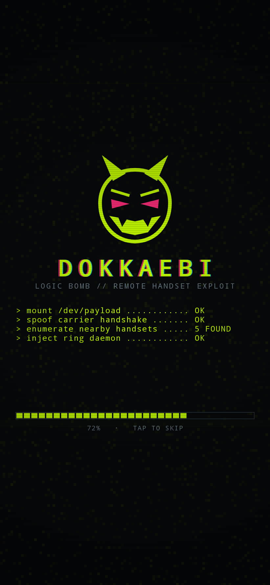

# Dokkaebi — hacker tablet prop app

An Android app styled after a hacker's "logic bomb" tablet: you ring a set of target
phones, watch them ring, and when a target "hangs up" you get a fake camera feed from
their device. It's a **prop/toy only**. It never places real calls or touches any other
device, and all art (the goblin-mask mark, HUD, camera feeds) is original and drawn in code.

| Tablet / landscape | Phone / portrait |
|---|---|
|  |  |
|  |  |

## Features
- **Boot sequence**: glitching title, scrambled subtitle, exploit log, segmented progress bar (tap to skip).
- **Target "caller" cards**: CALL → dialing → ringing (expanding rings, shaking handset, timer) → HANG UP → compromised.
- **LOGIC BOMB**: press and hold to arm, then it rings every idle target in a staggered burst. Uses 2 charges that recharge over 20 s.
- **Feeds**: each compromised target unlocks a "camera feed" that resolves out of static, with a REC dot, timestamp and slow pan.
- **Log**: a terminal event log that scrolls itself.
- **Config**: turn the ring tone and vibration on or off, set auto hang-up (0–30 s, or manual only), and add, rename or remove targets (saved between launches).
- CRT scanlines, vignette, rolling band, RGB-split glitch text, red alert border while anything rings.
- The ring tone is synthesized at runtime, so there are no audio files. Fullscreen, keeps the screen on, and adapts to phone and tablet sizes in either orientation.

## Build & install
Requires JDK 17+ and the Android SDK (API 35).

```bash
./gradlew assembleDebug
```

```bash
adb install -r app/build/outputs/apk/debug/app-debug.apk
```

Or open the folder in Android Studio and press Run. Min Android version: 8.0 (API 26).

## Screenshot tests
The screens are rendered on the JVM with Robolectric + Roborazzi (no emulator needed):

```bash
./gradlew :app:testDebugUnitTest -Proborazzi.test.record=true
```

Output goes to `app/screenshots/`.

## Code map
- `TabletState.kt`: `TabletViewModel` holds targets, call state machine, charges, log and settings.
- `audio/Feedback.kt`: synthesized ring loop, blips and vibration patterns.
- `ui/BootScreen.kt`, `ui/TabletScreen.kt`: the screens.
- `ui/Effects.kt`: CRT, glitch/scramble text, static noise, hex grid, HUD brackets.
- `ui/Mask.kt`: the goblin-mask mark (also in `res/drawable/ic_launcher_foreground.xml`).

Fan-made and not affiliated with any game publisher.
