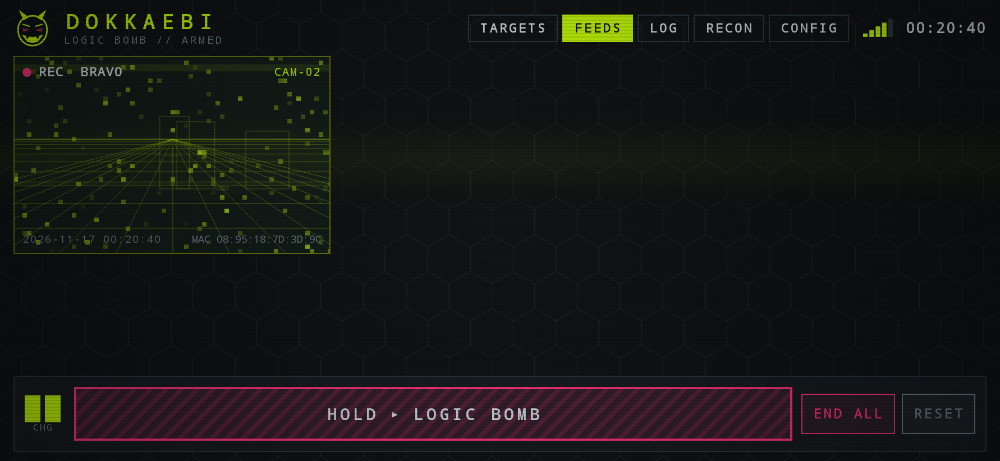
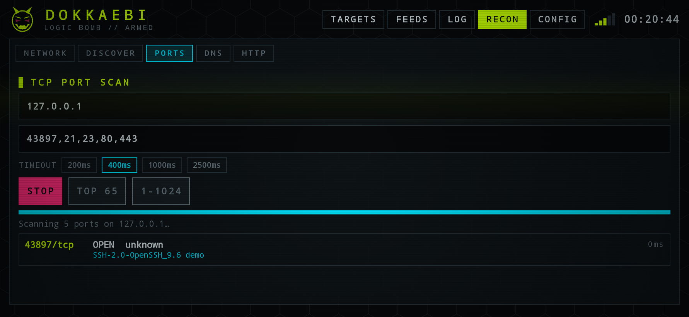
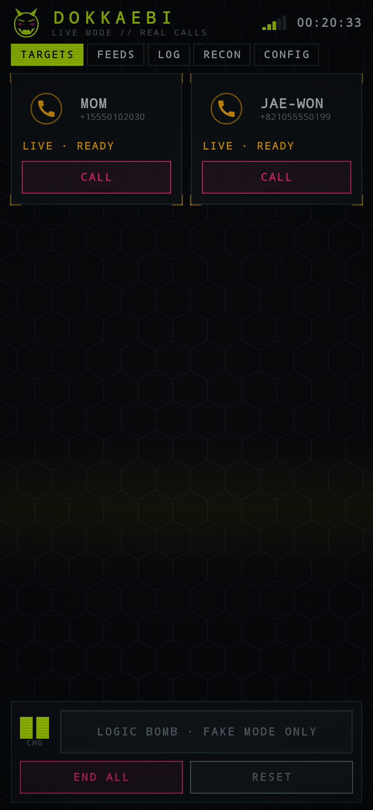

# Dokkaebi — hacker tablet prop app

An Android app styled after a hacker's "logic bomb" tablet: you ring a set of target
phones, watch them ring, and when a target "hangs up" you get a fake camera feed from
their device. All art (the goblin-mask mark, HUD, camera feeds) is original and drawn in code.

It has two contact modes, **FAKE** (everything simulated) and **REAL** (calls your actual
phone contacts), plus a **RECON** tab with real network reconnaissance tools.

| Tablet / landscape | Phone / portrait |
|---|---|
|  |  |
|  |  |
|  |  |

## Features
- **Boot sequence**: glitching title, scrambled subtitle, exploit log, segmented progress bar (tap to skip).
- **Target "caller" cards**: CALL → dialing → ringing (expanding rings, shaking handset, timer) → HANG UP → compromised.
- **LOGIC BOMB**: press and hold to arm, then it rings every idle target in a staggered burst. Uses 2 charges that recharge over 20 s.
- **Feeds**: each compromised target unlocks a "camera feed" that resolves out of static, with a REC dot, timestamp and slow pan.
- **Log**: a terminal event log that scrolls itself.
- **Contact modes** (CONFIG → CONTACT MODE):
  - **FAKE TARGETS**: the simulated flow above. No calls leave the device.
  - **REAL CONTACTS**: import people with the system contact picker (no address-book permission
    needed), or type a name and number. CALL places a real call. Android asks for call permission
    the first time; if you decline, the dialer opens with the number filled in instead. An optional
    confirmation dialog guards against accidental taps. Logic bomb and feeds are disabled in this
    mode, so real calls only ever go out one at a time when you press CALL.
- **RECON** (real tools; one-time "authorized use only" acknowledgement):
  - **NETWORK**: transport, interface, IPv4/subnet, gateway, DNS servers, IPv6, validation, metering.
  - **DISCOVER**: sweeps your local subnet (narrowed to a /24) with TCP connect probes, treating a
    reset as proof a host is up, then an echo fallback. Shows hostname, latency, and open common ports.
    Tap a host to port-scan it.
  - **PORTS**: concurrent TCP connect scan (`top`, `all`, `22,80,8000-8100`), adjustable timeout,
    banner grabbing (SSH/FTP/SMTP greetings; HTTP status line and `Server:` header).
  - **DNS**: forward and reverse lookups, plus TCP "ping" to any port (works where ICMP is blocked).
  - **HTTP**: no-redirect HEAD/GET audit: status, server, six security headers (HSTS, CSP,
    X-Frame-Options, X-Content-Type-Options, Referrer-Policy, Permissions-Policy), cookie flags
    (Secure/HttpOnly/SameSite), and TLS certificate subject, issuer, expiry, SANs and cipher.
  - Scans run as an unprivileged app: TCP connect only, no raw packets or SYN scans, no root.
    Results go to the LOG tab.
  - **Only scan networks and hosts you own or have written permission to test.**
- **Config**: turn the ring tone and vibration on or off, set auto hang-up (0–30 s, or manual only), and add, rename or remove targets (saved between launches).
- CRT scanlines, vignette, rolling band, RGB-split glitch text, red alert border while anything rings.
- The ring tone is synthesized at runtime, so there are no audio files. Fullscreen, keeps the screen on, and adapts to phone and tablet sizes in either orientation.

## Build & install
Requires JDK 17+ and the Android SDK (API 35).

```bash
./gradlew assembleDebug
```

```bash
adb install -r app/build/outputs/apk/debug/app-debug.apk
```

Or open the folder in Android Studio and press Run. Min Android version: 8.0 (API 26).

## Permissions
| Permission | Why |
|---|---|
| `CALL_PHONE` | REAL mode direct calls (runtime prompt; declining falls back to the dialer) |
| `INTERNET`, `ACCESS_NETWORK_STATE` | RECON tools |
| `VIBRATE` | ring and button haptics |

Cleartext HTTP is allowed so the HTTP audit can inspect `http://` services on your LAN.

## Tests
Unit tests (`app/src/test/.../recon/NetToolsTest.kt`) cover port-spec parsing, subnet math, header
and cookie grading, phone-number cleanup, and a real loopback scan with banner grabbing.

## Screenshot tests
The screens are rendered on the JVM with Robolectric + Roborazzi (no emulator needed):

```bash
./gradlew :app:testDebugUnitTest -Proborazzi.test.record=true
```

Output goes to `app/screenshots/`.

## Code map
- `TabletState.kt`: `TabletViewModel` holds targets, contact mode, call state machine, charges, log and settings.
- `RealCaller.kt`: real-call flow (permission, confirmation, dialer fallback) and the contact picker.
- `recon/NetTools.kt`: scanning, discovery, banner grabbing, DNS and HTTP/TLS audit (plain JVM, unit-tested).
- `recon/NetInfo.kt`, `recon/ReconViewModel.kt`, `ui/ReconScreen.kt`: the RECON tab.
- `audio/Feedback.kt`: synthesized ring loop, blips and vibration patterns.
- `ui/BootScreen.kt`, `ui/TabletScreen.kt`: the screens.
- `ui/Effects.kt`: CRT, glitch/scramble text, static noise, hex grid, HUD brackets.
- `ui/Mask.kt`: the goblin-mask mark (also in `res/drawable/ic_launcher_foreground.xml`).

Fan-made and not affiliated with any game publisher.
